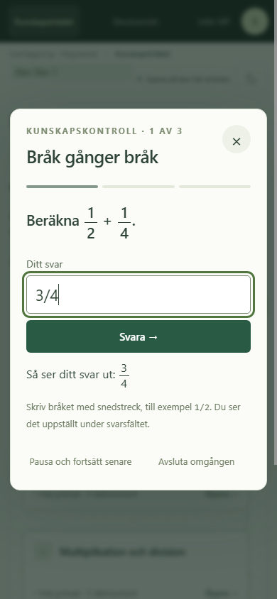
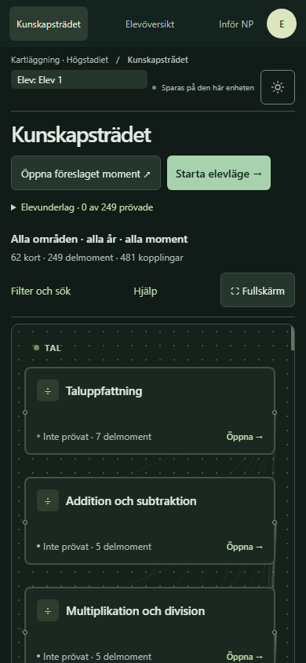

# Mobilkarta och uppställda bråk

2026-10-21. Utgångsversion `32cf83d`. Beställda mobil-/NP-ändringar och bråkvisning är genomförda. Innehållsförsöken nedan är dokumenterade förslag; frågebanken och bedömningströsklarna är oförändrade.

## Genomfört

| Del | Nytt beteende |
|---|---|
| Mobilkarta | Filter är hopfällda från början vid högst 550 px. Område, årskurs och nivå syns ovanför kartan. **Filter och sök** öppnar kontrollerna; aktiv sökning syns även när de fälls ihop. |
| Rotation och återkomst | Separata visningsval för mobil/desktop och normal/fullskärm bevaras inom den öppna sidan. Rotation återställer respektive val; dialogretur ändrar inte det. Omladdning använder standardläget igen. |
| Fullskärm | Aktiv elev, temaknapp och **Avsluta fullskärm** är synliga även med hopfällda filter. |
| Kopplingar | Linjer dämpas på mobil. Tangentbordsfokus eller tryck på ett kort markerar dess samband, även sedan pekaren lämnat kartan. **Fler val → Visa alla kopplingar** finns i både grupp- och delmomentsvy. Inga kanter, `pairs` eller motiveringar tas bort. |
| Inför NP | **Kartlagt underlag – ingen provprognos** står nära huvudrubriken före resultaträknarna. Den längre avgränsningen och bokreferenserna finns kvar. |
| Bråk | Täljare över bråkstreck och nämnare i frågor, alternativ, förklaringar, elevsvar, historiska rapporter, matematiska motiveringar och träddiagrammens sannolikheter. Även symboler som ½ får samma uppställning. |
| Svar | Enligt användarens val skriver eleven exempelvis `3/4` i **ett fält** och ser en uppställd förhandsvisning direkt under, både manuellt och automatiskt. Inskrivningshjälpens exempel behåller snedstreck så att det framgår vilka tecken eleven ska skriva. |

Bråkvisningen är ett presentationslager. Ursprunglig frågetext, facit, alternativordning och förklaring sparas som tidigare. Utkast som `2/`, `0`, `0,75` och `1 / 2` ändras inte. Förhandsvisningen räknar inte ut svaret eller godkänner det; även nämnare noll kan visas, men avvisas vid inskickning enligt befintlig tolkning. Formatkravet för nya decimalfrågor gäller fortsatt. Urval och bedömning är oförändrade, inklusive `courseYears`, `selection:'course'`, `catalogue:'assessed'`, `coveragePolicy:'exhaustive'` och äldre sessioners regler. Misslyckanden stoppar inte övriga delar i nya uttömmande pass.

Enheter som km/h och m/s, äldre kalkylbladsformler och datum görs inte om till bråk. Resultaträknare som 2/3 rätt behåller vanligt format. Bråken har skärmläsarnamn med täljare/nämnare, men verklig skärmläsare har inte provats. Ursprunglig bråktext finns kvar för kopiering och DOM-läsning. Den frysta elevadaptern kunde fortfarande läsa frågans bråk; `innerText` innehåller nu radbrytningar runt dem. Förtesta en fryst tolk före nytt elevexperiment, utan facitstyrd trimning.

## Bildnamn: inventerat, inte ändrat

Ett genererat exempel per aktuell delmomentsvariant gav fem relevanta bildfall: tre figurvarianter, ett prickfall och en tallinjevariant. Detta är en mallinventering, inte frekvensen i elevpass. [Fullt stickprov](reviews/2026-10-21/second-improvements/image-names.json).

| Uppgift/syfte | Nuvarande bildnamn | Bedömning och litet pilotförslag |
|---|---|---|
| `f-count`: räkna objekt | Exempelvis ”8 prickar.” | Ger slutsvaret. En alternativ uppgift med grupper om tre respektive två föremål och frågan hur många tillsammans har svaret 5. Den ger stöd för sammanläggning av givna antal, **inte samma underlag om visuell prickräkning**. Pröva även taktila/lärarledda alternativ. |
| `former`: hörn, sidor, namn | Namnger rektangel, femhörning etc. | Namnkunskap kan ersätta avläsning. Vid ”Vilken figur visas?” ges svaret direkt. Prova roterade/olika proportionerade figurer och separat egenskapsfråga; klassificeringen ska inte ligga i bildnamnet. En text som anger antalet sidor prövar begreppskoppling, inte visuell identifiering. |
| `f-fraction-line`: läsa A | Anger antal lika steg och vilket steg A står vid. | Ger tillräckliga data utan positionsavläsning. Pilot: fem lika steg från 0 till 1, A vid tredje steget. Oberoende svar 3/5. En textbaserad motsvarighet kan pröva del av helhet men ger annat representationsunderlag än visuell tallinjeavläsning. |

[W3C:s förklaring av WCAG 1.1.1](https://www.w3.org/WAI/WCAG22/Understanding/non-text-content.html) beskriver ett testundantag när en textmotsvarighet skulle göra en visuell/sensorisk uppgift ogiltig. Bedöm uppgiftens syfte; ta inte bort alla beskrivningar. En allmän etikett ensam gör inte matematiken tillgänglig. Nästa pilot behöver en meningsfull alternativ väg samt verklig skärmläsare och berörda användare. Ingen sådan lösning infördes här.

## Liten bokjämförelse

Två moment valdes enligt fortsättningsprompten. Jämförelsen använder lokalt OCR-underlag från angivna PDF-sidor samt **slutligt laddade** noder och frågor. [Nod- och frågestickprov](reviews/2026-10-21/second-improvements/book-sample.json).

**Positionssystemet:** Matte Direkt 7, Tal, PDF-sida 5 / tryckt sida 10 beskriver platsvärden, nollans funktion, sammansättning av tal och förändringar med hela tiotal/hundratal. Appens tre varianter frågar efter en siffras värde, bygger ett tresiffrigt tal och räknar hela tiotal. Begreppen ansluter till boken; kontrollen täcker färre representationer och resonemang.

**Former & hörn:** Matte Direkt 7, Geometri, PDF-sida 6 / tryckt sida 59 tar upp månghörningar, sidor/hörn, diagonaler samt kroppar/utvikningar. Appen prövar antal hörn, antal sidor och figurnamn. Ett godkännande styrker inte hela boksidan. Kroppar har också egna delmoment.

För båda är `learnedAt:'1-3'` avsiktligt och `courseYears:['7']` kopplar till bokens återkomst. `f-place` respektive `f-shapes` är sammanslagna äldre ID:n. Positionssystemet återkommer i kartans `yearViews` för åk 8–9; detta placerar det inte automatiskt i nya pass där. Stickprovet visar inte något årskursfel.

Laddning: `curriculum.js` → katalog/utökningar → `foundations.js` → sammanslagning → granskade frågor → `questions-mixed.js` → presentation. Slutliga platsvärdesvarianter kommer från `questions-reviewed.js`, figurvarianterna från `questions-reviewed-foundations.js`; flervalslagret tillämpas efteråt. Generatorerna ändrades inte.

Två egna pilotförslag, ännu inte inlagda eller elevprovade:

- **Platsvärde:** ”En elev säger att 405 och 45 betyder samma tal eftersom nollan inte är värd något. Stämmer det? Förklara.” Oberoende lösning: nej, 405 har fyra hundratal och fem ental; 45 har fyra tiotal och fem ental. Ett korrekt resonemang stödjer nollans roll i exemplet. Ett ensamt nej bevisar inte detta; uppgiften kräver resonemangsbedömning.
- **Månghörningar:** ”Varför kan man inte rita en diagonal i en triangel?” Oberoende lösning: varje par av olika hörn sitter redan ihop med en sida; en diagonal förbinder icke angränsande hörn. Resonemanget stödjer diagonalbegreppet för triangeln. Det ska inte automatiskt godkänna figuravläsning eller hela geometrin.

## Kartläggning, komplettering och lärande

**Första kartläggning:** automatiskt elevläge väntar med facit till rapporten. **Komplettering:** läraren väljer en riktad kontroll och granskar metod/representation utöver tidigare underlag. **Lärande:** manuella kontroller ger rätt/fel och förklaring efter varje svar; senare svar kan lämnas efter återkoppling inom omgången.

Kunskap efter återkoppling är också kunskap, men underlagen är inte identiska mätningar utan stöd. Ett avgränsat försök kan dokumentera given hjälp och jämföra nya överföringsuppgifter före/efter återkoppling. Det motiverar inte ändrade trösklar eller automatiskt godkända förkunskaper. Ingen ny mätmetod/status infördes.

## Övriga innehållsförsök

**Sannolikhet:** [KONTRASTTEST_SANNOLIKHET.md](KONTRASTTEST_SANNOLIKHET.md) innehåller simulerade frysta prov, ännu inte införda eller elevvaliderade. Ny pilottext ska ange att varje kvarvarande kula är lika sannolik att dras, skilja återläggning från ingen återläggning och pröva antal kvar, andra draget efter given färg och båda ordningarna. Behåll varje försök och skilj parserfel, avstående och simulerad felidé. Nästa kontroll är ett förslag, ingen säker diagnos.

**Tusentalsgruppering:** separat möjligt försök. Nu gäller heltal utan mellanslag. Förbered strikta grupper om tre siffror med uttryckligt stöd för vanliga/hårda/tunna mellanslag och avvisningsfall som `1 2`, blandade separatorer och felplacerat decimaltecken. Bevara äldre frågors regler/råsvar; ta inte globalt bort mellanslag. Ingen svarstolk ändrades här.

## Verifiering och begränsningar

- `python tests/run_browser.py` — **PASS på slutlig produktkod**: 86 700 frågor, graf, 51 gruppprojektioner, 38 uttömmande urval, förkunskapsresultat, historik, pausade frågor/utkast, export/import och 390 px utan sidöverflöde.
- `python tests/ui_preview.py tests/second-improvements-scenarios.json` — **PASS**: mobilstandard/sökning/rotation/dialog/fullskärm, tangentbords-/pekmarkering, bråk/algebra/HTML-escaping, oförändrade källsträngar, faktisk inmatning och Enter exakt en gång. Nämnare noll bedömdes inte som svar. Första omgångens äldre import-/exportprov passerade också.
- `python tests/ui_preview.py tests/second-improvements-visual.json` — **PASS**: skärmbilder vid 390 och 1366 px, båda teman, automatisk förhandsvisning, avslut och sparad rapport, träddiagram, fryst DOM-läsning, bokstickprov och bildnamn. Syntetiska frågor är tekniska UI-fixturer, inga naturliga elevpass.
- Punktmätt bråktext i manuell fråga: **10,36:1 ljust**, **12,49:1 mörkt**. Hjälptext, platshållare och fokus provades också. Ingen full WCAG-/skärmläsarvalidering påstås.

Första fokusprovet misslyckades eftersom headless Chrome saknade emulerat aktivt fönster: `focus()` flyttade DOM-fokus utan normala fokushändelser. Testverktyget emulerar nu aktivt fönster. Testselektorer för ett kort utan yttre kanter och vägen till avslutad rapport rättades också. Inga elevmodeller trimmades. Skärmbilderna ledde till produktfixar för blek bråktext i elevläget, en för bred rapportregel för `span` och träddiagrammets rubrikavstånd; full regression kördes därefter.

Detta är avgränsade tekniska prov/innehållsgranskning. De fem tidigare AI-granskarnas 37 frågor täckte fem av nio områden utan avsiktliga felsvarsserier; begränsningen gäller fortfarande. Ingen pedagogisk helhetsvalidering påstås. Orelaterade filer bevarades. [Fortsättningsprompt](FORTSATT_HELHETSGRANSKNING_PROMPT.md).
