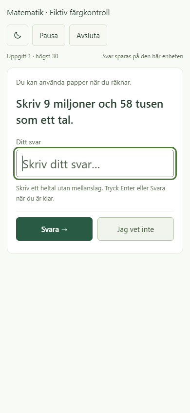
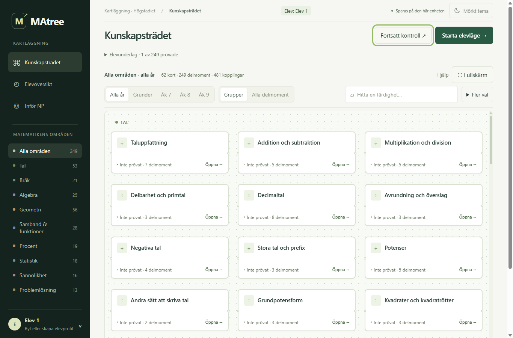

# Första förbättringsomgången efter helhetsgranskningen

2026-10-21. Utgångsversion `9fde562`; sedan den granskade produktversionen `45c362e` hade endast granskningsmaterial tillkommit. De sex beställda förbättringarna är genomförda. Grön palett, urvalsregler och bedömningströsklar är bevarade.

## Före och efter

| Del | Före | Efter |
|---|---|---|
| Start av baspass | ”Alla delmoment … undersöks” trots exempelvis 79 delmoment och högst 30 frågor. | Visar antalet delmoment och att passet fortsätter tills delarna prövats eller gränsen nås. Förklarar att flera frågor används per delmoment och att delar kan bli oprövade. |
| Ljust tema | Blek metodtext, svarsetikett, lagringsbesked och sidfot. | Gemensam semantisk sekundär textfärg; tydligare svarsfältskant, platshållartext och tangentbordsfokus. Mörkt tema använder motsvarande befintliga ljusa textfärg. |
| Bråkmultiplikation | Nya variant 0-frågor om multiplikation beskrev division med invers. | Multiplikation förklarar täljare gånger täljare och nämnare gånger nämnare. Heltalsfaktorn förklaras som ett bråk med nämnaren 1. Division behåller sin inversförklaring; korsförkortning behåller sin egen slutliga generator. |
| Gruppstatus | Helt oprövade grupper visade enbart ”Visad kunskap: 0/7”. | ”Inte prövat · 7 delmoment”. Blandat underlag visar exempelvis ”1 visat · 2/5 prövade”. Både synlig text och tillgängligt namn uppdateras. |
| Nästa kontroll | ”Nästa steg” kunde öppna ett allmänt ingångsmoment utan motivering på resultatkortet. | Målmoment och motivering visas före klick. Resultatet och elevöversikten använder samma beskrivning av allmän breddning, förkunskapskontroll, fortsatt uppföljning eller sparad omgång. |
| Format och nämnare | Grupperat heltal avvisades med ”Skriv ett heltal”; nämnarfrågan uppmanade också till ett helt bråksvar. | Hjälp och formatfel anger ”Skriv ett heltal utan mellanslag”. Nämnarfrågan frågar villkorligt vilket tal som står i nämnaren. |

Samma nästa delmoment väljs i samma prioritetsordning som tidigare; ändringen gör motivet synligt. En oprövad förkunskap beskrivs uttryckligen som en separat undersökning, inte en fastställd orsak. Gruppens nämnare utgår fortsatt från medlemmarna i aktuellt karturval. Indirekt eller lärarbekräftat underlag görs inte om till direkt visad kunskap.

Vanligt baspass och **Testa alla** har fortsatt olika urval. Tomma basurval ger fortfarande tydligt besked och spärrad start. `courseYears`, `selection:'course'`, `catalogue:'assessed'`, `coveragePolicy:'exhaustive'` och äldre sessioners regler är oförändrade. Misslyckanden stoppar inte prövning av övriga delar i nya uttömmande pass.

## Historiskt underlag

Endast nygenererade frågetexter och förklaringar rättas. Äldre sparade frågor behåller även sina ursprungliga formuleringar och förklaringar. Inga migreringar eller ändrade facit infördes. Svarstolken är oförändrad: `13 089 000` och `1 2` accepteras fortfarande inte; nu är det tydligt att mellanslagen ska tas bort. Kontrollerad tusentalsgruppering återstår som separat förbättring.

Ett fryst tekniskt stickprov med 15 frågor sparades **före** ändringarna i [tests/first-improvements-before.json](tests/first-improvements-before.json). Reproducerbar slumpning efter ändringen gav samma facit, svarsalternativ, alternativvärden och bilder. Endast de avsedda förklaringarna och nämnarinstruktionen fick avvika. Division och slutlig korsförkortning var helt oförändrade.

En fiktiv profil importerades med detta äldre underlag: manuell historik, en pausad manuell fråga med sparat alternativ samt en pausad automatisk bråkmultiplikationsfråga med ofärdigt svar `2/`. Historisk rapport, återupptagning, explicit paus och faktisk export behöll frågeobjekten och utkasten exakt. Detta var en teknisk regression med syntetisk profil, inte ett blindtest av en elev.

## Läsbarhet och visuellt prov

Punktmätningar på faktiska renderade bakgrunder:

| Text | Ljust | Mörkt |
|---|---:|---:|
| Metod-/förslagstext i elevöversikt | 6,45:1 | 7,88:1 |
| Lagringsbesked och sidfot | 6,00:1 | 9,07:1 |
| Ditt svar, automatisk elevvy | 6,45:1 | 7,88:1 |
| Ditt svar, manuell dialog | 6,26:1 | 7,88:1 |

Hjälptext, platshållare och flervalsknappar kontrollerades också på sina aktuella ytor. Text i inaktiva kontroller dokumenterades utan att använda den som godkännandekrav. Normal, vald, inaktiv och tangentbordsfokuserad kontroll granskades; verkliga klick och tangenttryck verifierade svarsfältets fokus. Temaväxling lämnade den fiktiva profilens frågor och utkast oförändrade.

Skärmbilder granskades vid 1366/1440 px och 390 px. Elevlägets fråga, svar, Jag vet inte och temakontroll behåller sina funktioner. Detta är avgränsade färg- och UI-prov, inte ett påstående om fullständig WCAG-överensstämmelse eller ett test med fysisk mobil/skärmläsare.

## Verifiering

- `python tests/run_browser.py` — **PASS** på den färdiga produktkoden. Bland annat 86 700 genererade frågor, oberoende facitfall, graf och grupper, 38 uttömmande årskurs-/områdesurval, äldre frågeobjekt, återupptagning, utkast, export/import och mobilbredd.
- `python tests/ui_preview.py tests/first-improvements-scenarios.json` — **PASS**. Stort/litet/tomt urval och Testa alla, gruppens aktuella urval, samma mål/motivering i rapport och översikt samt faktisk import/återupptagning/export av äldre sparade frågor och båda typerna av utkast.
- `python tests/ui_preview.py tests/first-improvements-visual-scenarios.json` — **PASS**. Punktmätningar, kontrollägen, temaväxling utan ändrad elevdata samt skärmbilder av automatiskt/manuellt läge och översikt.

Det riktade testets första körning sökte rekommendationen i fel panel eftersom automatiska pass lägger till en panel före den. Testselektorn rättades till panelen med den avsedda rubriken. Ingen produktändring gjordes för detta testfel. Visuella prov ledde därefter till den färdiga fokus- och platshållarfärgen; full regression kördes på nytt efter de sista produktändringarna.

[Sparat UI-resultat](reviews/2026-10-21/first-improvements/ui.json) och färg-/fokusmätningar samt utvalda bilder finns under [reviews/2026-10-21/first-improvements](reviews/2026-10-21/first-improvements/). Inga verkliga elevprofiler användes. Orelaterade PDF:er, bilder och arbetsfiler bevarades.

## Nästa omgång, ännu inte införd

1. **Mobilkarta:** prova hopfällda filter som standard på smal skärm, en kort synlig urvalssammanfattning och en tydlig väg tillbaka till filter/sök. Dämpa linjer eller visa främst valt korts samband; behåll alla underliggande kopplingar, gruppkanternas `pairs` och en uttrycklig möjlighet att visa dem.
2. **Inför NP:** lägg en kort ”Kartlagt underlag – ingen provprognos” nära rubriken. Behåll den längre avgränsningen och bokreferenserna. Grön kurs och Genrepet är inte en officiell NP-kravlista.
3. **Tillgängliga bilder:** inventera bland annat prickar, figurnamn och tallinjer utifrån vad uppgiften frågar. Prickantalet i bildnamnet kan ge svaret. Välj en liten meningsfull alternativ uppgiftsform och redovisa om den ger annat underlag; ta inte bort alla alternativtexter. Pröva med riktig skärmläsare före slutsatsen att problemet är löst.
4. **Frågebredd och bokanknytning:** följ slutlig generator och sammanslagning för exempelvis Former & hörn och Positionssystem i åk 7. Jämför en liten, förhandsvald uppsättning med boken innan kursplacering eller fråga ändras. Behåll möjligheten att pröva tidigare grunder.
5. **Manuellt kontra automatiskt:** kommunicera att senare manuella svar lämnas efter återkoppling. Skilj kartläggning, komplettering och lärande utan att ogiltigförklara kunskap som visats efter förklaring. Ändra inte trösklar eller arbetssätt utan ett avgränsat försök.
6. **Kontrastkontroll med/utan återläggning:** fortsätt från [KONTRASTTEST_SANNOLIKHET.md](KONTRASTTEST_SANNOLIKHET.md). Ange lika sannolika drag i nya pilottexter, frys före mätning och skilj parserfel från avstående. Detta förslag är fortfarande inte infört eller elevvaliderat.

[Uppdaterad fortsättningsprompt](FORTSATT_HELHETSGRANSKNING_PROMPT.md) avgränsar nästa leverans. De fem AI-granskarnas omdömen och de tekniska testerna ersätter inte lärar-/elevprov eller validering av hela frågebanken.
