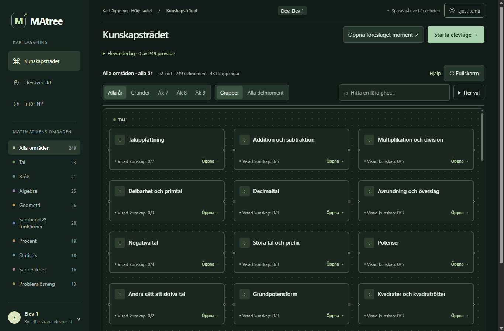
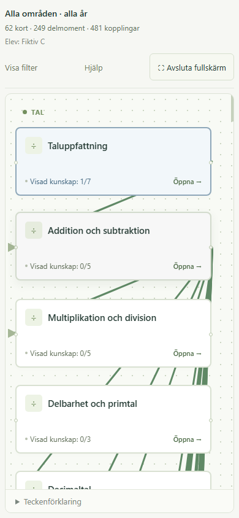
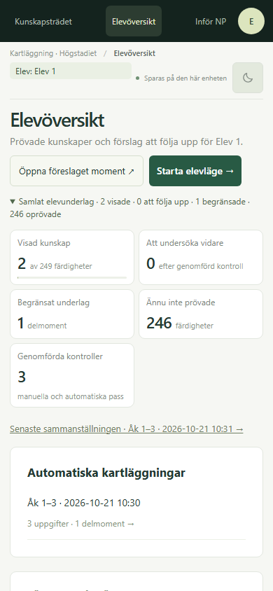

# Helhetsgranskning av MAtree

2026-10-21 · granskad version `45c362e` · fem separata granskarinstanser och en sammanvägning.

**Uppföljning:** Den första förbättringsomgångens sex beställda ändringar är nu genomförda och verifierade. Se [före/efter och kvarstående arbete](FORBATTRINGAR_FORSTA_OMGANGEN.md). Granskningen nedan och originalrapporterna beskriver fortfarande versionen som faktiskt granskades; deras observationer har inte skrivits om retroaktivt.

MAtree har en tydlig kärna: en karta över delmoment, en lugn arbetsyta där eleven besvarar en fråga i taget och rapporter som låter läraren granska det faktiska underlaget. Det som främst behöver förbättras är **hur läraren hittar rätt, hur begränsat underlaget kommuniceras och hur frågornas olika representationer ger jämförbar information**. Det finns också konkreta fel i en förklaring och konkreta kontrastproblem. Underlaget talar för avgränsade förbättringar, inte för att bygga om hela appen eller byta bedömningsmodell på en gång.

Detta är simulerad expertgranskning. Fem instanser av en språkmodell är inte fem lärare eller elever, och deras samstämmighet är ingen användarstatistik. Inga verkliga elevprofiler användes. Ingen produktkod ändrades under granskningen.

## Hur granskningen genomfördes

Granskarna startades med tom samtalskontext, gemensam version och samma breda bedömningsområden: UX, frågor och matematik, bedömningsmetod, språk, färg och tillgänglighet. De fick olika ingångsperspektiv men skulle alla granska helheten. De läste inte tidigare rapporter eller varandras fynd. Första intrycken och frågelösningen kom före eventuell kodspårning. Körningarna gjordes i två vågor av kapacitetsskäl, i separata Chromeprofiler. Den senare vågen fick inga fynd från den första.

Sammanvägaren läste rapporterna, kontrollerade utvalda fynd mot slutladdad app/kod, mätte ytterligare textkontraster och verifierade att sex centrala publicerade filer matchade lokalversionen. Alla praktiska granskningar avsåg lokalversionen; detta var inte en full jämförelse av varje publicerad fil. [Versionskontroll](reviews/2026-10-21/public-version.json).

De fristående rapporterna bevaras tillsammans med sina begränsningar. Ett stickprov som inte hittade ett facitfel innebär inte att resten av banken är validerad. Antalet frågor nedan är granskarnas försök, inte ett antal unika frågemallar.

Totalt redovisas **37 besvarade frågor**, delvis överlappande. Granskarna hittade inget numeriskt facitfel i dessa svar. B redovisar att bildbeskrivningen röjde antalet i en prickfråga före egen räkning; den räknas inte som en helt blind jämförelse. Ett korrekt tal med mellanslag avvisades före registrering i D:s prov och redovisas som formatproblem, inte ett rättat felsvar.

| Granskare | Ingångsperspektiv | Faktiskt frågestickprov | Rapport |
|---|---|---|---|
| A | Ny lärare, praktiskt arbetsflöde | 6 svar, Tal/Geometri/Bråk | [A](reviews/2026-10-21/A.md) |
| B | Osäker elev och ny lärare | 7 svar, Tal/Bråk/Geometri; ett svar exkluderat från blind jämförelse | [B](reviews/2026-10-21/B.md) |
| C | Visuell hierarki och tillgänglighet | 9 svar, Geometri/Tal/Statistik | [C](reviews/2026-10-21/C.md) |
| D | Lärarens resultattolkning | 9 svar, Geometri/Tal/Bråk; även Inför NP | [D](reviews/2026-10-21/D.md) |
| E | Ny lärare, val av undersökning | 6 svar, Geometri/Tal/Procent; även Inför NP | [E](reviews/2026-10-21/E.md) |

### Hur rapporterna sammanfaller och skiljer sig

- Alla fem beskriver en sammanhållen form och begränsar uttryckligen vad deras få svar kan visa. De provade rapporterna gav användbart underlag och ingen granskare fann en blockerande krasch i sitt flöde.
- A, B, D och E lyfter gruppkortens 0/N som en tolkningsfråga. A och E dokumenterar hur öppna filter skjuter ned mobilkartan; C lyfter i stället linjernas dominans i mobil fullskärm. Det är närliggande problem, inte identiska reproduktioner.
- C och E upptäcker täckningslöftet oberoende i två årskursurval. B och C gör olika punktmätningar av svaga ljusa texter. Att A, D och E inte mätte detta är inget motbevis.
- B:s bildnamn och D:s siffergruppering/Nästa steg är enskilda fynd med konkret belägg. Ett viktigt problem behöver inte upptäckas av en majoritet för att prioriteras.
- Ingen jämförbar numerisk användbarhetspoäng kan räknas fram från dessa olika stickprov. Prioriteringen nedan bygger på konsekvens, säkerhet och åtgärdens omfattning, inte röstning.

## Det som är bra och bör bevaras

**Elevläget har en tydlig uppgift.** En fråga i taget, stora kontroller och ett uttryckligt Jag vet inte ger mindre konkurrens än trädet. I de prövade flödena fungerade numerisk inmatning, Enter och separation mellan paus och avslut. Det är en bra bas för elever som behöver koncentrera sig på matematiken.

**Rapporterna ger insyn i underlaget.** Granskarna kunde se elevens svar, facit och förklaringar. Manuellt avbrutna pass blev begränsat underlag i de prövade exemplen; oprövade delmoment redovisades separat. Det gör det möjligt för läraren att kontrollera vad en färg eller status faktiskt bygger på.

**Förkunskaper godkänns inte genom ett senare rätt svar.** Den lokala bedömningen och formuleringen av nästa kontroller som förslag är viktiga skydd mot för stora slutsatser. Dessa egenskaper ska inte förenklas bort när UX förbättras.

**Uttrycket är sammanhållet.** Den gröna paletten, återkommande kort och tydliga områdesnamn uppfattades som lugna. Det mörka temats provade huvudtexter har stark kontrast. Fullskärm och vissa mobil-/tangentbordsvägar fungerade i stickproven. Detta stöder att utveckla det befintliga formspråket vidare.

**Frågorna i UI-stickproven var ofta korta och konkreta.** De kontrollerade lösningarna omfattade bland annat platsvärde, bråk av antal, figurigenkänning, vinklar och tabellavläsning. Det är en användbar grund, även om många exempel bara prövar en liten del av vad ett brett momentnamn kan betyda.

*Startvyn har en sammanhållen form och tydlig elevlägesknapp, men många samtidiga val. Bild från en tom fiktiv profil.*

## UX: tydlig elevuppgift, mer krävande lärarorientering

Kartan rymmer 249 aktiva delmoment i nio områden, med 56 grupper och sex fristående kort. Storleken är en styrka för överblick över möjliga luckor, men en ny användare behöver samtidigt förstå grupp kontra delmoment, årskurs kontra tidigare grunder, automatisk kontroll kontra manuell kontroll och sammanlagt underlag kontra ett visst pass.

Samtliga rapporter beskriver någon form av orienteringsarbete eller informationsmängd på kartan. Det är ett kvalitativt mönster, inte ett uppmätt misslyckande hos verkliga användare. Första förbättringen bör vara att göra det vanligaste arbetsflödet tydligare: **välj elev → välj vad som ska undersökas → starta → granska svar → välj nästa kontroll**. Behåll trädet för utforskning, men låt inte dess fulla detaljnivå vara förklaringen till hur man börjar.

Två mindre ändringar har tydliga belägg:

- Helt oprövade grupper visar ”Visad kunskap: 0/N”, medan delmoment visar ”Inte prövad”. Skriv exempelvis ”Inte prövat · 7 delmoment” på helt oprövade grupper. När underlag finns kan både visade och prövade räknas. Ändra visning, inte sparade resultat eller gruppens aktuella urval.
- På 390×844 upptog öppna navigerings-/filterdelar så mycket plats att första kortet i A:s observerade läge började runt y=673. I C:s mobila fullskärm konkurrerade långa kopplingslinjer med korten. Försök med hopfällda filter som mobilstandard och mer återhållsam visning av linjer. Dessa är avgränsade layoutobservationer; en riktig pekskärm har inte prövats.

*Kort och kopplingslinjer behöver en annan visuell balans på smal skärm. Fullskärmsfunktionen i sig fungerade i det prövade flödet.*

### Nästa steg behöver säga vad det faktiskt är

D fick 3/3 på Bråk som del av en hel. Resultatknappen ”Nästa steg” öppnade sedan Ekvation: addition och subtraktion utan motivering på just resultatkortet. Kodspårning bekräftar att valet kan komma från en allmän lista med ingångsmoment. Elevöversikten förklarar redan detta som en allmän startpunkt för fortsatt kartläggning, inte en slutsats från senaste svaret.

Återanvänd den förklaringen där valet görs och visa målmomentet före klick, exempelvis ”Nästa kontroll: Ekvation … · bredda kartläggningen”. Det behövs inget löfte om att nästa kontroll är en säker undervisningsrekommendation efter bråk. Fyndet gäller beskedet, inte ett bevis för att ekvationsfrågor är fel att undersöka.

## Frågor och språk: korrekt slutsvar räcker inte som kvalitetsmått

### En bekräftad förklaring behöver rättas

Sammanvägaren verifierade även ett tidigare noterat, kvarstående problem. Efter full laddningsordning genererade `brak-heltal-mult` och `brak-multiplikation`, variant 0, multiplikationsuppgifter med förklaringen ”Vid division multipliceras med det andra bråkets invers.” Exempel: **3/9 × 4/7** fick den förklaringen, trots att operationen är multiplikation. Det numeriska facit i exemplet motsvarar 4/21. Detta är ett bekräftat problem med återkopplingens relevans, inte ett påvisat fel i den numeriska rättningen och inte ett extra oberoende agentfynd. [Slutladdade exempel](reviews/2026-10-21/fraction-explanations.json), [generatorn](questions-reviewed-highschool.js).

Rätta förklaringen för nya multiplikationsfrågor separat från division. Samma kontroll visade att korsförkortning redan fått en egen förklaring senare i filen; felet ska därför inte beskrivas som om alla fyra närliggande moment fortfarande delar samma slutliga text. Bevara historiska sparade frågeobjekt exakt.

### Rätt matematisk lösning ska inte fastna i en oklar formatregel

D skrev **13 089 000** på ”Skriv 13 miljoner och 89 tusen som ett tal”. Samma fråga låg kvar med ”Skriv ett heltal”. Utan mellanslag accepterades **13089000** och rättades korrekt. Sammanvägaren bekräftade att slutladdad `parseAnswer` avvisar både vanlig och hård blankstegsgruppering men accepterar det ogrupperade talet. [Kontroll av svarstolken](reviews/2026-10-21/number-parser.json).

Det registrerades alltså inget felaktigt matematikresultat, men hjälpen förklarade inte varför ett begripligt heltal avvisades. Minsta rättning är tydlig formatvägledning. Kontrollerad acceptans av tusentalsgruppering ger sannolikt bättre flöde, men ska prövas separat så att exempelvis ”1 2” inte godtyckligt tolkas som 12 och äldre regler inte ändras oavsiktligt.

D fann också en nämnarfråga som först säger att andelen ska skrivas som bråk och sedan frågar efter nämnaren, medan alternativen är heltal. Formulera den som ett villkor: ”Om du skriver andelen som ett bråk utan att förkorta, vilket tal står i nämnaren?” Frågan ska ha en tydlig svarshandling. Detta är ett språk-/instruktionsproblem, inte ett konstaterat facitfel.

### Bildbeskrivning kan ändra vad uppgiften prövar

B såg frågan ”Hur många prickar ser du?” där bildens tillgängliga namn var **”13 prickar.”** Koden bygger detta från det sökta antalet. Namnet identifierar alltså inte bara bilden utan ger slutsvaret. Den som får namnet uppläst behöver inte genomföra samma räkneuppgift. B:s eget prickförsök är därför uttryckligen undantaget från helt blind facitjämförelse.

Ta inte bort alternativtexter överallt. Bestäm i stället vad som ska prövas för varje figurtyp och erbjud en meningsfull tillgänglig uppgiftsform eller en tydlig anpassad kontroll. Om uppgiften blir en annan ska underlagets innebörd framgå. W3C behandlar uttryckligen tester där en full textbeskrivning skulle ogiltigförklara testet; en beskrivande identifiering är då relevant. Det är inte ett skäl att låta en elev stå utan tillgänglig väg. [W3C om icke-textinnehåll och testundantaget](https://www.w3.org/WAI/WCAG22/Understanding/non-text-content.html).

### Frågornas bredd och årskursanknytning behöver ett eget granskningssteg

A fick hörn och sidor på samma sexhörning; C fick kvadratens hörn, triangelns sidor och igenkänning av triangel. Sådana frågor kan vara korrekta men närbesläktade. Det behövs variation i representation, motivering eller överföring om resultatet ska användas för bredare slutsatser än just de prövade rutinerna.

C:s uttryckliga Åk 7-pass började med grundläggande former och därefter hundratal/tiotal. Att en högstadieelev kan behöva tidigare grunder ingår i appens syfte. Samtidigt bör ett valt kursår inte kännas som ett grundpass utan förklaring. Granska därför några konkreta årskurs-/momentkombinationer mot bokinnehållet och de slutliga generatorerna. Detta stickprov visar en fråga om nivå och mappning, inte att hela `courseYears` är fel eller att enkla frågor generellt ska tas bort.

## Metod: lokal evidens med synliga begränsningar

Manuella kontroller kräver 3/3 för visad kunskap. Automatiska pass kan visa ett delmoment efter minst tre rätt och högst ett fel; två fel eller avståenden ger uppföljning, annars är underlaget begränsat. Skillnaden är beskriven i gränssnittet och bekräftad i kod. Det är inget programfel bara för att reglerna skiljer sig, och granskarna har inte visat att någon annan tröskel är bättre.

Det viktiga är att **Visad** alltid går att läsa som ett resultat i de prövade uppgifterna. Ett korrekt slutsvar kan bygga på rutin, gissning eller bredare förståelse. Appen registrerar svaret; en förklaring eller överföringsuppgift behövs för att undersöka mer. Reservationerna finns redan men bör synas nära statusen även när man lämnat rapportsidan. Ändra inte statusnamn eller trösklar genom en global textsökning utan att bevara historik och olika underlagstyper.

E påpekar dessutom att manuell kontroll visar återkoppling efter varje svar, medan det prövade automatiska läget väntade med facit till rapporten. Senare manuella svar kan därför lämnas efter att eleven har fått en förklaring. Det gör inte kunskapen ogiltig, men underlagen samlas inte under identiska förhållanden. Tydliggör syftet — första kartläggning, komplettering eller lärande — innan dessa resultat jämförs som om bara tröskeln skilde dem åt.

Ett konkret kommunikationsfel är starttexten: **”Alla delmoment i urvalet undersöks, men högst 30 uppgifter.”** C valde Åk 7, alla områden: urvalet innehöll 79 delmoment. E såg samma löfte i Åk 9 med 57 delmoment. Ett 30-frågorspass kan då inte pröva alla ens en gång, och flera frågor används per delmoment. Rapporten räknade oprövade korrekt; löftet före start var problemet. Skriv exempelvis: ”Urvalet innehåller 79 delmoment. Passet fortsätter inom urvalet tills delarna prövats eller gränsen 30 svar nås.” Förklara att ett kort pass kan lämna delar oprövade. Bevara fortsatt prövning efter svårigheter och de gamla pausade passens regler.

Förslag på förkunskaper är möjliga nästa undersökningar, inte orsaksförklaringar. Den riktade kontrastkontrollen från tidigare arbete är ett separat, ännu inte infört produktförslag. Den nya helhetsgranskningen ger inget stöd för att automatiskt godkänna förkunskaper, tvinga alla genom gröna kedjor eller beräkna en betygs-/NP-prognos.

D och E öppnade Inför NP och såg att sidan avgränsar basräknaren till kartlagt underlag och uttryckligen avstår från betyg/provprognos. Det är bra. E noterade att denna avgränsning hamnade nedanför första mobilskärmen efter globala räknare och introduktion. Flytta en kort sådan mening nära rubriken, utan att ta bort den mer utförliga förklaringen. Varken bokmappningens alla kopplingar eller någon officiell NP-kravlista verifierades i denna granskning.

## Färg och tillgänglighet: behåll paletten, rätta svaga användningar

Att tycka att grönt känns lugnt är en estetisk bedömning. Att en viss text har låg luminanskontrast går att mäta. Dessa ska hållas isär.

| Synligt element | Tema | Uppmätt kontrast, ungefär | Underlag |
|---|---|---:|---|
| Nodrubrik | Mörkt | 12,49:1 | Sammanvägarens DOM-punktprov |
| Nodrubrik | Ljust | 12,15:1 | Samma |
| Statusrad på gruppkort | Ljust | 5,04:1 | Samma |
| Metod-/förslagstext i elevöversikt | Ljust | 3,37:1 | B:s mätning |
| Ditt svar-etikett i elevläge | Ljust | 3,63:1 | C:s mätning |
| Besked om lagring i toppfält | Ljust | 2,97:1 | Sammanvägarens DOM-punktprov |
| Sidfotstext | Ljust | 2,49:1 | Samma |
| Inmatningskant mot vit yta | Ljust | 1,37:1 | C:s mätning; bedöm komponentens övriga kännetecken separat |

W3C:s referens för normal text är minst 4,5:1, med bland annat undantag för stor text. För identifierande kontroll-/grafikdelar är referensen 3:1; det betyder inte att varje dekorativ kant måste nå 3:1. De svaga små texterna ovan är relevanta kandidater för rättning. Detta är punktprov av CSS-färger, inte en fullständig tillgänglighetsbedömning eller ett påstående att hela appen uppfyller en standard. [Textkontrast](https://www.w3.org/WAI/WCAG22/Understanding/contrast-minimum.html), [icke-textkontrast och avgränsningar](https://www.w3.org/WAI/WCAG22/Understanding/non-text-contrast.html).

Prioritera mörkare semantiska textfärger för hjälp, metod och små etiketter i ljust tema. Behåll skillnaden mellan områdesfärg, kursnivå och elevresultat med ord och symboler, inte enbart färg. Testa de faktiska vyerna i båda teman, inklusive vald flervalsknapp och fokus. Små texter kan behöva större grad även när färgkvoten räcker.

*Blek sekundär text kan bära viktig tolkningshjälp. Att dölja den eller lägga till fler förklarande rader löser inte läsbarhetsproblemet.*

## Prioriterad fortsättning

Prioritet **först** betyder bäst första leverans med tydligt belägg och begränsad ändring, inte att en säkerhetskritisk skada har påvisats.

| Ordning | Åtgärd | Belägg | Verifiera efter ändring |
|---|---|---|---|
| Först | Sant startbesked om urval och uppgiftstak | C, E och kod | Stort urval/litet tak, litet urval, tomt basurval, Testa alla |
| Först | Relevant förklaring för nya bråkmultiplikationer | Sammanvägarens slutladdade kontroll av tidigare känt problem | Båda operationerna, berörda generatorer och exakt bevarad äldre fråga |
| Först | Läsbar ljus metod-/hjälptext och etiketter | B, C och mätningar | Samma element på faktisk bakgrund, båda teman och fokus/valt läge |
| Först | Tydligare formatvägledning och enhetlig nämnarinstruktion | D och kod/svarstolk | Grupperat tal avvisas begripligt eller accepteras enligt uttrycklig regel; korrekt bråk/heltal |
| Först | Oprövade grupper och målet för Nästa steg tydliggörs | A/B/D/E respektive D + kod | Tom/blandad grupp, aktuellt urval, allmän ingång kontra riktad uppföljning |
| Därefter | Mer användbar mobilkarta, kort NP-avgränsning nära rubrik | A/C/D/E, olika delar | 390px, fullskärm, sökning, filter, vald nod och åtkomliga kopplingar |
| Separat avgränsat försök | Meningsfull tillgänglig motsvarighet till bildräkning | B och bildrenderer | Riktig skärmläsare, matematiskt syfte och tydlig innebörd för underlaget |
| Separat avgränsat försök | Frågebredd, nivå/bokanknytning och kompletterande konceptfrågor | A/C/E:s stickprov och tidigare piloter | Några förhandsvalda moment, oberoende lösningar och bevarade försök |

Den första leveransen kan alltså förbättra sanningshalten och läsbarheten utan att ändra bedömningströsklar. Därefter bör ett litet praktiskt prov med faktiska lärare undersöka om de kan välja rätt kontroll och tolka ett blandat resultat. Ett motsvarande elevprov bör undersöka språk, navigation och frågor med varierande förkunskaper. Fem AI-instansers bedömningar kan prioritera sådana prov, men ersätter dem inte.

[Föreslagen fortsättningsprompt](FORTSATT_HELHETSGRANSKNING_PROMPT.md) avgränsar nästa implementation och dess verifiering. Produktändringarna ovan är ännu inte genomförda.

## Begränsningar och bevarat underlag

Detta var en kvalitativ expertgranskning i emulerad desktop/mobil Chrome. Frågestickproven täcker **fem av nio områden**: Tal, Bråk, Geometri, Statistik och Procent. Algebra, Samband & funktioner, Sannolikhet och Problemlösning fick inga nya besvarade frågor i just denna omgång. Ingen granskare gjorde ett nytt fullständigt automatiskt pass eller en avsiktlig två-fels-/avståendeserie; reglerna för dessa utfall lästes i kod men felvägarna prövades inte praktiskt på nytt.

Hela uppgiftsbanken, alla årskursmappningar, bokterminologin i alla kapitel, fysisk mobil, verklig skärmläsare, kognitiv belastning hos faktiska elever, läraröverensstämmelse och psykometrisk validitet har inte granskats uttömmande. Fullständig import/export, säkerhet och långtidshållbar lagring var inte uppdragets testade bredd. Ingen ny full produktregression kördes eftersom ingen produktkod ändrades.

Granskare A:s automatiska säkerhetsgranskning stoppade ett inmatningsförsök där fältet kunde vara dolt. Efter DOM-kontroll användes en selektor för det synliga textfältet; inget dolt fält manipulerades och inget återstår blockerat. B:s prickfråga hade oavsiktlig exponering för bildnamnets antal och redovisas inte som en blind matematikkontroll. Övriga begränsningar, avbrutna flöden och mindre verktygsmissar framgår av respektive originalrapport.

Alla orelaterade filer bevarades. Rapporten ändrar inga elevresultat, sparade frågor, facit, svarsalternativ, utkast, pausade pass eller exportformat.
